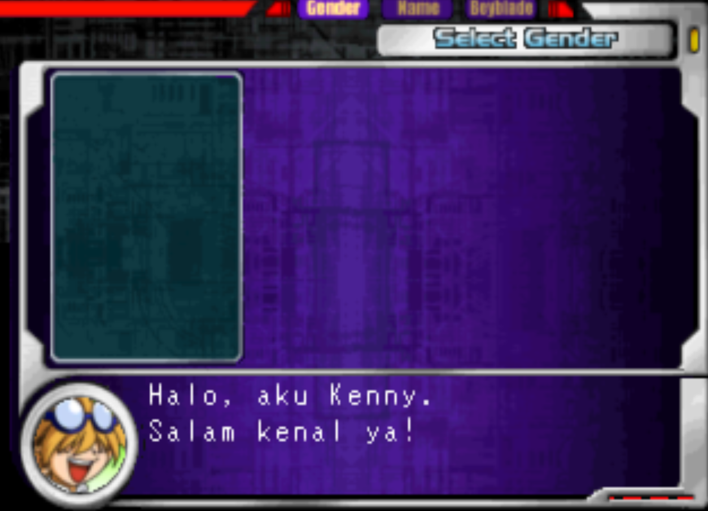
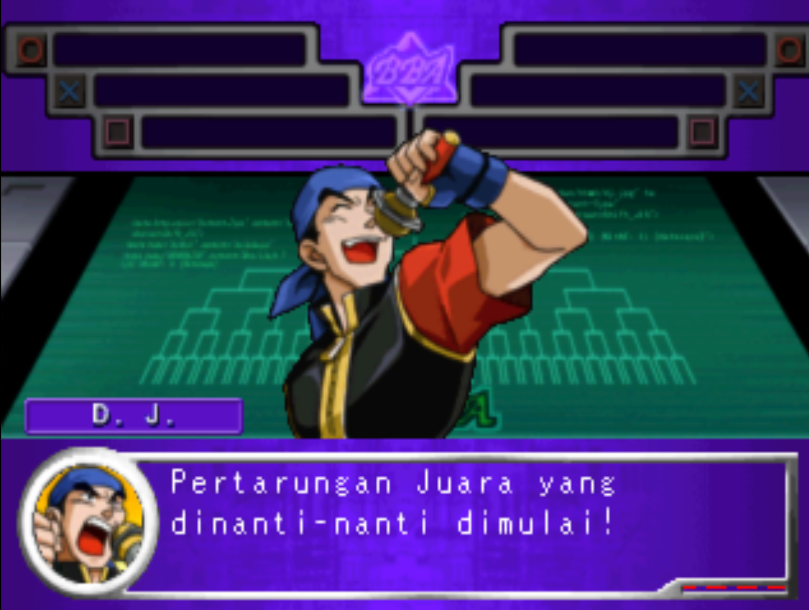
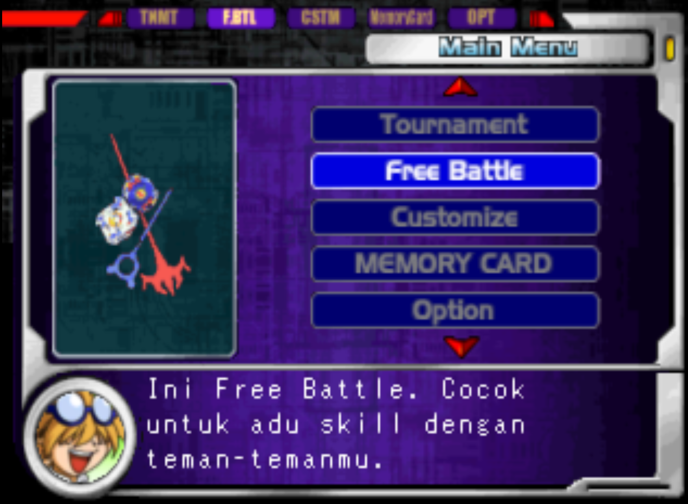

# Beyblade (PS1) - Indonesian Translation

Unofficial Indonesian fan translation for *Beyblade* (PlayStation, NTSC-U, `SLUS-01489`).

The patch rewrites the in-game text inside three overlay files (`MENUBIN.GRP`, `CSTMBIN.GRP`, `BTLBIN.GRP`) in place. File sizes, disc layout and string offsets are unchanged, so no filesystem rebuild is needed. Only 12 sectors of the data track are modified.



## Contents

- [Screenshots](#screenshots)
- [Status](#status)
- [Requirements](#requirements)
- [Compatibility](#compatibility)
- [Usage](#usage)
- [Translation file](#translation-file)
- [Disc and file format](#disc-and-file-format)
- [Translation constraints](#translation-constraints)
- [Contributing](#contributing)
- [Known issues](#known-issues)
- [Credits](#credits)
- [Legal](#legal)

## Screenshots

<table>
  <tr>
    <td>
      
    </td>
    <td>
      
    </td>
  </tr>
</table>

## Status

| Component | Status |
|---|---|
| Menu, save/load and MEMORY CARD messages (`MENUBIN.GRP`) | Translated |
| Tournament announcer lines (`MENUBIN.GRP`) | Translated |
| Customize help text, part descriptions, shop dialogue (`CSTMBIN.GRP`) | Translated |
| Battle shouts and commentary (`BTLBIN.GRP`) | Translated |
| Character names, part names, move names | Left in English |
| Debug / error strings (`ERROR: Efx...`) | Left in English |
| Text stored as graphics (TIM images: menu buttons, `GO`, `SHUT`, logos) | Not translated |
| FMV (`BBOP.STR`, `BB_END.STR`) | Not translated |

332 of 446 text strings found in the three files are translated. The remaining 114 are names, part names and debug strings intentionally kept as-is.

## Requirements

- A legitimate copy of the game, dumped to `.bin/.cue`
- An IPS patcher (Floating IPS, Lunar IPS, or similar)
- An emulator (DuckStation or similar) or modded hardware

## Compatibility

The patch targets the data track (Track 1) of the US release. Other regions, revisions or re-dumps with different data are untested.

Original `Track 1` image (raw 2352-byte sectors, 102,895,296 bytes, 43,748 sectors):

```
MD5     : 94562e857ecddb0e9de6db6e89ef375c
SHA-1   : 6b89ee5937508ca83cf496eb8cd7e249291adbf1
SHA-256 : 6d4261669c222a8941bb84f87472411d424157ea8343c7f6d3a31419879c2b17
```

Patched output (same size):

```
MD5     : be148aa732d29e76141a1031ad76d9f6
SHA-1   : f73eafb0a2aecb0a1fd705696950e9c7e2fd94dc
SHA-256 : bb591e58c8e5bf422a486fae60ac67bee259d87cdbc808990e1bb9bf1651f992
```

`Beyblade_ID.ips` itself:

```
MD5     : 7c9210b38705a89e6bf696650bdf7956
SHA-1   : cce30bfbf79144cb19830896b2fe8713a30ed14b
SHA-256 : 00db179a4df9f11ffa685482b52dd82ecc922c6be3ec6b330579148b6ea57850
```

## Usage

1. Dump your disc to `.bin/.cue`. Keep the audio tracks (Track 2 and later) as they are; they are not modified.
2. Verify the hash of the data track (`Track 1`) against the table above.
3. Make a copy of the original `Track 1` `.bin`.
4. Apply `Beyblade_ID.ips` to the copy with your IPS patcher.
5. Keep the original `.cue` file. The patched `.bin` has the same size, so the cue sheet does not need changes.
6. Load the `.cue` in your emulator.

Always patch a copy.

## Translation file

`translation/Beyblade_naskah_EN-ID.txt` lists every translated string in file order:

```
[MENU 0x000EC]
EN: I see. Your name is / zz.
ID: Oh, begitu. Namamu / zz.
```

| Field | Description |
|---|---|
| `[MENU / CSTM / BTLB 0x....]` | Source file (`MENUBIN`, `CSTMBIN`, `BTLBIN`) and byte offset of the string inside that file |
| `EN` | Original text (line breaks shown as ` / `) |
| `ID` | Translation (line breaks shown as ` / `) |

## Disc and file format

**Image.** Raw `MODE2/2352` data track. Game files are stored in Form 1 sectors (2048 bytes of user data at offset +24). After editing, the EDC and ECC of each modified sector are recomputed, so the image stays valid for tools that check them.

**Files.**

| File | LBA | Size (bytes) | Content |
|---|---|---|---|
| `MENUBIN.GRP` | 152 | 147,028 | Menu code, save/load messages, tournament commentary |
| `CSTMBIN.GRP` | 224 | 74,428 | Customize mode, part descriptions, shop |
| `BTLBIN.GRP` | 261 | 242,428 | Battle mode, shouts and commentary |

Modified sectors: `152-155`, `224-229`, `261-262`.

**Strings.** Plain ASCII, null-terminated, aligned to 4 bytes, with manual line breaks (`\n`). No custom encoding table is needed.

**Pointers.** The three overlays load at the same base. A file offset maps to a RAM address as:

```
address = 0x80082254 + file_offset
```

Strings are referenced either by 32-bit pointers in data tables or by `lui` / `addiu` pairs in code. The patch does not move any string and does not touch pointers or code.

**Slots.** The slot of a string spans from its start to the next non-zero byte. The patcher writes the translation at the start of the slot and zero-fills the rest of the old text.

## Translation constraints

- A translation, including its null terminator, must fit in the original slot.
- Keep `\n`, `%s`, the name placeholders (`zz`, `xx`) and the button glyph `}` where they are, in the same count.
- Keep line width at or below the longest original line of that file (30 characters for `MENUBIN`, 28 for `CSTMBIN`, 30 for `BTLBIN`), and do not add more lines than the original box uses.
- Use only characters that already appear in the original strings. All current translations pass this check; the font itself has not been dumped.
- Some strings are fragments that the game shows together with another string (for example the MEMORY CARD warnings, which continue across messages). Translations must read correctly when joined.
- Part names and character names are kept in English so they match the graphics (TIM images) that cannot be translated yet.

## Contributing

1. Find the string by file and offset in `translation/Beyblade_naskah_EN-ID.txt`.
2. Propose a new `ID` line that fits the slot (see [Translation constraints](#translation-constraints)).
3. Open a pull request, or an issue that lists the file, offset and proposed text.

For rendering bugs (text out of the box, wrong line count, garbled characters), include a screenshot, the emulator and version, and the string offset.

## Known issues

- Not tested end to end on every mode.
- Some strings are shortened to fit the original slot.
- Text box width and height were estimated from the original English text. Some lines may overflow in-game.
- A few MEMORY CARD and tournament messages are fragments; their translation was written without seeing the surrounding context.
- The default beyblade name `Unregistered` is changed to `Belum Daftar` (same length, 12 characters).
- Menu buttons and other text stored as graphics are still in English.
- Only one game revision has been tested.

## Credits

- The Handsome Guy: [Nopal]
- Original game: Takara / Hasbro, Beyblade (PlayStation)

## Legal

This is a non-commercial fan project and is not affiliated with Takara, Hasbro, or any rights holder of Beyblade. This repository does not contain any game data, ISO or ROM. You must supply your own legally obtained copy. Do not redistribute patched game images.
